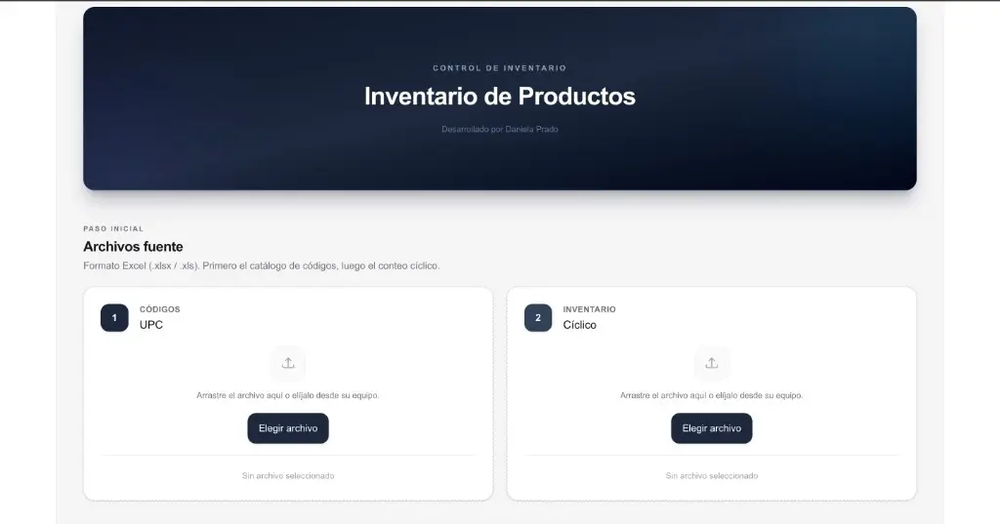

# 👋 Hola, soy Daniela Prado

### Full Stack Developer | Ingeniera en Sistemas Computacionales

Profesional en Ingeniería en Sistemas Computacionales enfocada en el desarrollo de aplicaciones web Full Stack. Me especializo en crear soluciones digitales funcionales, integrando interfaces intuitivas, lógica de negocio y funcionalidades backend para responder a necesidades reales.

🌐 **Portafolio:** [portafolio-daniela-prado.vercel.app](https://portafolio-daniela-prado.vercel.app/)

---

## 🚀 Proyectos destacados

<table>
<tr>
<td width="50%" valign="top">

<h3 align="center">Share Fashion</h3>

Plataforma web de comercio electrónico con catálogo de productos, filtros de búsqueda e información sobre pedidos y envíos.

<a href="https://sharefashion.vercel.app/">Ver proyecto →</a>

</td>
<td width="50%" valign="top">

<h3 align="center">Sistema de Gestión de Inventario</h3>

Aplicación web para la administración de productos, control de existencias y generación de reportes.

<a href="https://inventario-control.vercel.app/">Ver proyecto →</a>

</td>
</tr>
</table>

---

**Contacto**

[Portafolio](https://portafolio-daniela-prado.vercel.app/) · [LinkedIn](https://www.linkedin.com/in/danilevinger/)

